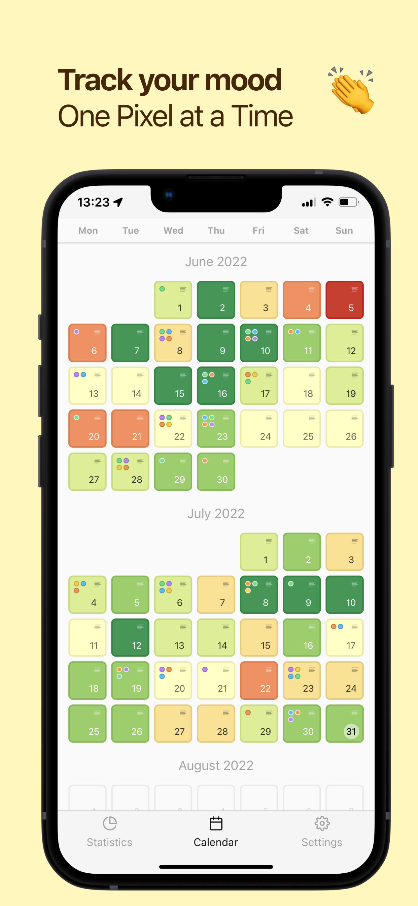

> [!NOTE]
> **Actively developed.** Latest source release: [releases/latest](https://github.com/mrzmyr/pixy-mood-tracker-app/releases/latest). Store versions are listed in [app facts](./docs/app-facts.json).

 

  

  <h3 align="center">Pixy Mood Tracker</h3>

  
Understand what makes you feel this way.

  

    <a href="https://apps.apple.com/de/app/pixy-mood-tracker/id1605327124">Apple App Store</a>
    ·
    <a href="https://play.google.com/store/apps/details?id=com.devmood.pixymoodtracker">Google Play Store</a>
  

## About The Project

  

Pixy Mood Tracker helps you understand what makes you feel the way you do. Log your mood, name your emotions, add tags and sleep, and see your year in pixels. Free on iPhone and Android, with no ads, no account, and no AI. Your entries stay on your phone.

- Log mood, 72 emotions with descriptions, tags, sleep, and notes. More than one entry per day.
- See what shapes your days: filters, tag peaks, monthly and yearly reports, and your year in pixels
- Entries stored on device. Export and import backups.
- Bring your history from 21 other apps in under 5 minutes with [Pixy Switch](https://pixy.day/switch)
- 31 languages ([docs/i18n.md](./docs/i18n.md))

Full list with status: [docs/app-facts.json](./docs/app-facts.json).

### Built With

- [React Native](https://reactnative.dev/)
- [Expo](https://expo.dev/) and [Expo Router](https://docs.expo.dev/router/introduction/)

## Development

See [docs/development.md](./docs/development.md) for setup, build, and release instructions.

## Contributing

See [CONTRIBUTING.md](./CONTRIBUTING.md).

## Contact

mrzmyr [@mrzmyr](https://twitter.com/mrzmyr)

Project Link: [https://github.com/mrzmyr/pixy-mood-tracker-app](https://github.com/mrzmyr/pixy-mood-tracker-app)

### Supported Languages

See [docs/i18n.md](./docs/i18n.md).
